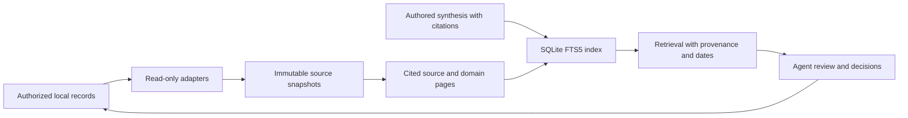

# physical_sys

A local-first agent toolkit for recording observations, maintaining a cited wiki,
and retrieving evidence for personal performance and rehabilitation follow-up.

This repository contains reusable agent code and project-local skills only.
It ships no personal profiles, health records, treatment plans, photos, documents,
conversation history, compiled knowledge, credentials, or local runtime bindings.

## What it does

- Records dated facts, observations, decisions, hypotheses and explicit corrections.
- Keeps SHA-256-addressed source snapshots and locatable provenance.
- Compiles source and domain pages into a Markdown wiki while preserving authored synthesis.
- Retrieves cited evidence using SQLite FTS5, Chinese bigrams and a small alias dictionary.
- Tracks intake, baseline, planning, execution, review, revision and archival checkpoints.
- Provides project-local orchestration, posture/physiotherapy and orofacial/TMJ support skills.

The system separates plans from observations, missing data from zero, and model
hypotheses from professional findings. Evidence stays on the machine where you run it.
The CLI makes no network or model API calls; a host agent may use external tools
only under its own permissions.

## Requirements

- Python 3.10 or later, with SQLite FTS5 support.
- Git for cloning. No third-party Python packages are required.
- A skill-capable agent host is optional; the CLI works independently.

## Quick start

```sh
git clone git@github.com:Bowen-Xue-ac2/physical_sys.git
cd physical_sys
python -m unittest discover -s tests -v
python -m physical_memory lifecycle
```

To try the full pipeline without personal data, record this **fictional** decision:

```sh
python -m physical_memory remember "Fictional demo: keep provenance with every decision." --domain memory --kind decision --evidence-kind record_state --date 2000-01-01 --source fixture://demo
python -m physical_memory retrieve "provenance"
python -m physical_memory lint
```

`remember` appends the event, ingests local sources and compiles the index. It
creates ignored `data/` and `vault/` directories. The demo date is deliberately
historical and does not represent a current measurement.

Use a separate private workspace for real records:

```sh
python -m physical_memory --root ../private-workspace ingest
python -m physical_memory --root ../private-workspace compile
python -m physical_memory --root ../private-workspace retrieve "your query"
```

Only use a workspace you are authorized to read. Place the optional
[vault rules template](templates/vault/AGENTS.md) in that workspace as
`vault/AGENTS.md`. Run `ingest` and `compile` before the first retrieval.

## Commands

| Command | Purpose |
| --- | --- |
| `ingest` | Snapshot supported local files without changing their contents |
| `compile` | Build generated wiki pages and rebuild the retrieval index |
| `retrieve QUERY` | Return excerpts, source references, record dates and freshness labels |
| `remember TEXT ...` | Append a provenance-bearing event; use `--supersedes ID` for corrections |
| `review --start DATE --end DATE` | Summarize evidence coverage within an inclusive date window |
| `lifecycle` | Inspect the current phase and allowed transitions |
| `lifecycle --to PHASE --reason TEXT` | Record an allowed transition and checkpoint |
| `lint` | Check source snapshot integrity and local wiki links |

Run `python -m physical_memory --help` or add `--help` after a command for options.
See [lifecycle and memory](docs/lifecycle.md) and [skills](docs/skills.md) for details.

## Architecture



| Path | Contents |
| --- | --- |
| `physical_memory/` | Standard-library memory, wiki, retrieval and lifecycle engine |
| `.agents/skills/` | Four independently authored project-local agent skills |
| `.agent/domain/schemas/` | Generic legacy interchange schemas; distinct from memory event fields |
| `templates/` | Empty-workspace rules, with no personal content |
| `tests/` | Synthetic fixtures created inside temporary directories |
| `scripts/check_public_tree.py` | Check the tracked file allowlist and common privacy hazards |

## Privacy and publication

Keep real data outside this public checkout. As a second layer, `.gitignore`
excludes profiles, logs, raw materials, generated vaults, runtime state, exports,
documents, databases and credentials. Ignore rules are not encryption and do not
protect files that have already been tracked.

Before every publication, inspect the staged diff and run:

```sh
python scripts/check_public_tree.py
git diff --cached --stat
```

The checker uses an exact tracked-file allowlist and common secret/path patterns.
It does not prove that arbitrary prose is free of personal information; review
every changed file. Do not attach private records to Issues or pull requests.

## Boundaries

This is an evidence-management and agent-support toolkit, not a clinically
validated device. It does not diagnose, prescribe, assess treatment clearance,
or infer readiness from source counts. Clinician restrictions take priority.
Posture and jaw observations do not establish causation.

Retrieval is lexical, not embedding-based. DOCX import reads document-body text;
XLSX import reads cell values and cached formulas without recalculation. PDF and
image files are preserved as snapshots and marked pending extraction; OCR is
not included. Snapshot/index storage is unencrypted. See [failure modes](docs/lifecycle.md#failure-modes).

## Tests and help

```sh
python -m unittest discover -s tests -v
python scripts/check_public_tree.py
```

Tests cover immutable snapshots, idempotent imports, corrections, historical
retrieval, Chinese queries, stale indexes, reference-material boundaries,
windowed coverage, lifecycle checkpoints and malformed inputs. They use no
personal dataset and do not validate medical recommendations.

For questions or bugs, open a [GitHub Issue](https://github.com/Bowen-Xue-ac2/physical_sys/issues)
with a minimal **synthetic** reproduction. Maintained by
[Bowen-Xue-ac2](https://github.com/Bowen-Xue-ac2).

## Design references

The implementation is independently written. Referenced projects are inspiration,
not bundled dependencies or claims of clinical validation:

- [HPI](https://github.com/karlicoss/HPI): adapters and source provenance.
- [wger](https://github.com/wger-project/wger): separate records from training plans.
- [LangGraph](https://github.com/langchain-ai/langgraph): explicit state and checkpoints.
- [Karpathy](https://github.com/karpathy): agent-maintained wiki/vault ideas; this is an independent implementation, not an official Karpathy project.

README organization follows the topics in GitHub's
[About READMEs](https://docs.github.com/en/repositories/managing-your-repositorys-settings-and-features/customizing-your-repository/about-readmes).
